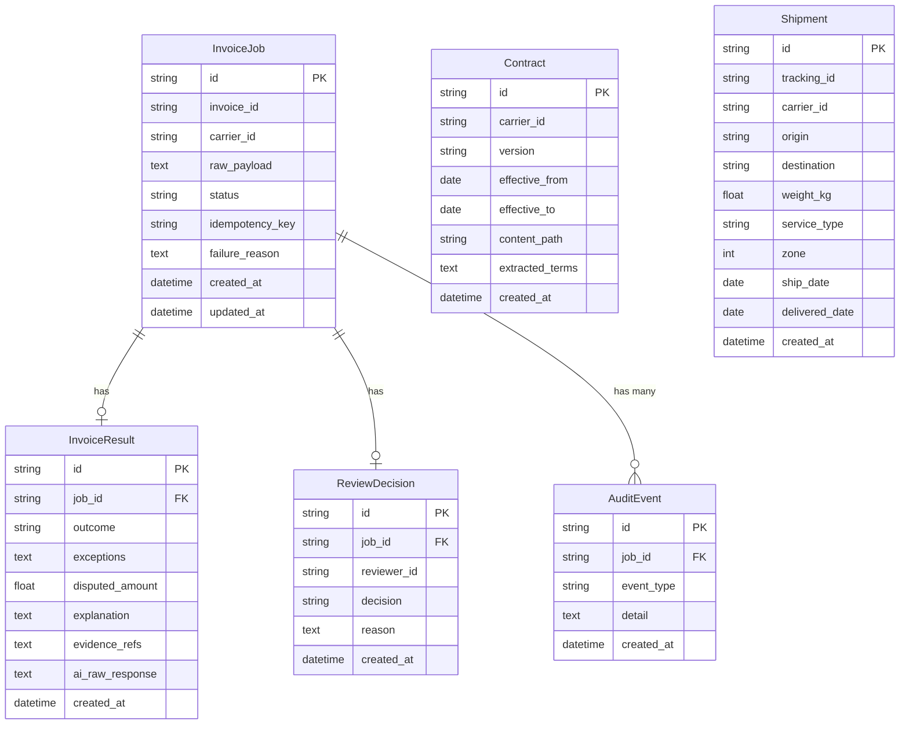

# AI Invoice Exception Review System — Design Document

---

## 1. Architecture Overview

```
┌────────────────────────────────────────────────────────────────┐
│                        Client (HTTP)                           │
└───────────────────────────┬────────────────────────────────────┘
                            │  REST API
┌───────────────────────────▼────────────────────────────────────┐
│                    FastAPI Application                         │
│  ┌────────────┐  ┌─────────────┐  ┌────────────────────────┐   │
│  │ /invoices  │  │  /reviews   │  │       /admin           │   │
│  │  router    │  │   router    │  │       router           │   │
│  └─────┬──────┘  └──────┬──────┘  └───────────┬────────────┘   │
│        │                │                     │                │
│  ┌─────▼────────────────▼─────────────────────▼─────────────┐  │
│  │           SQLAlchemy (PostgreSQL)                        │  │
│  │  invoice_jobs │ invoice_results │ review_decisions │     │  │
│  │  audit_events │ contracts       │ shipments        │     │  │
│  └──────────────────────────────────────────────────────────┘  │
│                                                                │
│  ┌────────────────────────────────────────────────────────┐    │
│  │        FastAPI BackgroundTasks Execution               │    │
│  │   process_invoice(job_id)                              │    │
│  │   ┌──────────────┐ ┌───────────────┐ ┌─────────────┐   │    │
│  │   │  Document    │ │  Exception    │ │   LLM       │   │    │
│  │   │  Service     │ │  Detector     │ │  Service    │   │    │
│  │   │  (contract   │ │ (deterministic│ │  (Gemini    │   │    │
│  │   │   terms)     │ │   rules)      │ │  + fallback)│   │    │
│  │   └──────────────┘ └───────────────┘ └─────────────┘   │    │
│  └────────────────────────────────────────────────────────┘    │
└────────────────────────────────────────────────────────────────┘
```

### Component Responsibilities

| Component | Responsibility |
|---|---|
| `routers/invoices.py` | Accept invoice submissions, enforce idempotency, enqueue `process_invoice`, return status/findings |
| `routers/reviews.py` | Record reviewer decisions, return audit history |
| `routers/admin.py` | Seed contract and shipment data from `data/` |
| `services/processor.py` | Asynchronous processing pipeline triggered by FastAPI `BackgroundTasks` |
| `services/document_service.py` | Load contracts, parse terms + citations deterministically, resolve date/version conflicts |
| `services/charge_calculator.py` | Deterministic rate calculations |
| `services/exception_detector.py` | Rule-based exception identification (rate mismatch, weight discrepancy, surcharges, duplicates) |
| `services/llm_service.py` | Generate natural-language explanations with Google Gemini and offline deterministic fallback |

---

## 2. Data Model



## 3. Workflow States

```
                    POST /invoices
                         │
                    ┌────▼─────┐
                    │ PENDING  │
                    └────┬─────┘
                         │  FastAPI BackgroundTasks triggers process_invoice(job_id)
                    ┌────▼──────────┐
                    │  PROCESSING   │
                    └────┬──────────┘
           ┌─────────────┼─────────────────┐
           │             │                 │
    ┌──────▼──────┐  ┌───▼──────────┐  ┌──▼──────┐
    │  COMPLETED  │  │ NEEDS_REVIEW │  │  FAILED │
    │ (outcome=   │  │ (ambiguous/  │  │ (perm.) │
    │  valid or   │  │  missing     │  └─────────┘
    │  exception_ │  │  evidence)   │
    │  detected)  │  └──────┬───────┘
    └──────┬──────┘         │
           │                │  POST /invoices/{id}/review
           └────────┬───────┘
                    │
             ┌──────▼───────┐
             │   REVIEWED   │  (ReviewDecision: APPROVED | REJECTED)
             └──────────────┘
```

**State transition rules:**
- `PENDING → PROCESSING`: Triggered asynchronously by FastAPI `BackgroundTasks` immediately after `POST /invoices`.
- `PROCESSING → COMPLETED | NEEDS_REVIEW`: Set upon successful exception evaluation.
- `PROCESSING → FAILED`: Set if an unrecoverable error occurs during processing.
- `COMPLETED | NEEDS_REVIEW → REVIEWED`: Via `ReviewDecision` creation.
- Once `FAILED`, job cannot be retried without manual intervention.

---